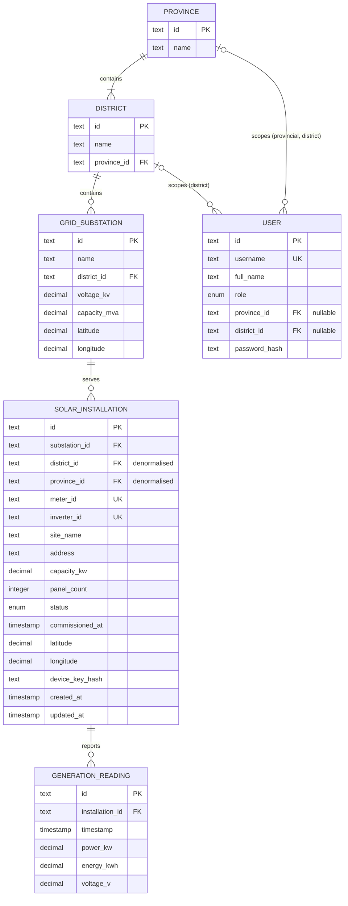

# Data model

The domain model for slsea-solar-api. It is independent of implementation: it
describes what the API is about, not how or where the data is stored. Section 4
records the implementation decisions made for the seed data.

## 1. Entities

Types are conceptual: `text`, `integer`, `decimal`, `timestamp` (ISO 8601 UTC),
and `enum` (a fixed set of values).

### Province

One of Sri Lanka's 9 provinces.

| Attribute | Type | Notes          |
| --------- | ---- | -------------- |
| id        | text | PK, e.g. `WP`  |
| name      | text | e.g. `Western` |

### District

One of the 25 districts. Each district is in exactly one province.

| Attribute   | Type | Notes                    |
| ----------- | ---- | ------------------------ |
| id          | text | PK, e.g. `COL`           |
| name        | text | e.g. `Colombo`           |
| province_id | text | FK -> Province, required |

### GridSubstation

A grid substation that rooftop installations connect to. Each one is in exactly
one district.

| Attribute    | Type    | Notes                    |
| ------------ | ------- | ------------------------ |
| id           | text    | PK, e.g. `SUB-001`       |
| name         | text    |                          |
| district_id  | text    | FK -> District, required |
| voltage_kv   | decimal | e.g. 132 or 220          |
| capacity_mva | decimal |                          |
| latitude     | decimal | WGS 84                   |
| longitude    | decimal | WGS 84                   |

### SolarInstallation

A rooftop solar system connected to one substation.

| Attribute       | Type      | Notes                                               |
| --------------- | --------- | --------------------------------------------------- |
| id              | text      | PK, e.g. `INST-0001`                                |
| substation_id   | text      | FK -> GridSubstation, required                      |
| district_id     | text      | FK -> District; denormalised copy (see 4c)          |
| province_id     | text      | FK -> Province; denormalised copy (see 4c)          |
| meter_id        | text      | unique; the grid meter's identifier                 |
| inverter_id     | text      | unique; the inverter's serial                       |
| site_name       | text      |                                                     |
| address         | text      |                                                     |
| capacity_kw     | decimal   | rated peak output, 2 to 20 kW                       |
| panel_count     | integer   |                                                     |
| status          | enum      | `active`, `inactive` or `maintenance`               |
| commissioned_at | timestamp | when it was connected                               |
| latitude        | decimal   | WGS 84                                              |
| longitude       | decimal   | WGS 84                                              |
| device_key_hash | text      | SHA-256 of the key the device uses to send readings |
| created_at      | timestamp |                                                     |
| updated_at      | timestamp |                                                     |

### GenerationReading

One measurement reported by an installation, every 15 minutes.

| Attribute       | Type      | Notes                                                                   |
| --------------- | --------- | ----------------------------------------------------------------------- |
| id              | text      | PK: installation id + compact UTC time, e.g. `INST-0001-20261005T0615Z` |
| installation_id | text      | FK -> SolarInstallation, required                                       |
| timestamp       | timestamp | when the measurement was taken                                          |
| power_kw        | decimal   | instantaneous output                                                    |
| energy_kwh      | decimal   | cumulative meter total; never decreases                                 |
| voltage_v       | decimal   | grid voltage at the meter                                               |

`(installation_id, timestamp)` is unique: an installation reports at most once per
slot. The id is built from exactly these two values.

### User

Someone who signs in to the API. Their role decides how much data they can see.

| Attribute     | Type | Notes                                                                    |
| ------------- | ---- | ------------------------------------------------------------------------ |
| id            | text | PK, e.g. `USR-001`                                                       |
| username      | text | unique                                                                   |
| full_name     | text |                                                                          |
| role          | enum | `admin`, `national`, `provincial` or `district`                          |
| province_id   | text | FK -> Province; required for `provincial` and `district`, otherwise null |
| district_id   | text | FK -> District; required for `district`, otherwise null                  |
| password_hash | text | bcrypt hash; the password itself is never stored                         |

## 2. Relationships

```
Province 1-* District 1-* GridSubstation 1-* SolarInstallation 1-* GenerationReading
```

- A Province contains one or more Districts. Each District is in exactly one Province.
- A District contains zero or more GridSubstations. Each GridSubstation is in exactly one District.
- A GridSubstation serves zero or more SolarInstallations. Each SolarInstallation is connected to exactly one GridSubstation.
- A SolarInstallation has zero or more GenerationReadings. Each reading belongs to exactly one installation.
- A User may be scoped to one Province (provincial role) or one District (district
  role), which sets their jurisdiction. Admin and national users are not scoped.



## 3. Modelling decisions

### (a) meter_id and inverter_id are attributes of SolarInstallation; there is no Device entity

**Decision.** The meter and the inverter are recorded as two unique identifiers on
the installation. They are not modelled as a separate Device entity.

**Justification.**

- Each installation has exactly one meter and one inverter, and the API never needs
  to query a device separately from its installation. A 1-1 relationship with no
  behaviour of its own doesn't need its own entity.
- Readings are reported per installation, and an installation is what users see,
  manage and are given jurisdiction over. A Device entity would add a join and an
  extra resource (`/devices`) without serving any requirement this API has.
- Uniqueness still holds: `meter_id` and `inverter_id` are unique across all
  installations, so either one can identify the installation behind a device.
- Replacing a device means updating one field; `updated_at` records when it happened.
  If device history, several meters per site, or device-level faults were needed
  later, Device could be extracted then.

### (b) GenerationReading is its own append-only time series, never last-value fields on the installation

**Decision.** Every measurement is a new GenerationReading row. Readings are only
ever added, never updated or deleted. SolarInstallation has no `current_power_kw` or
`last_reading_at` fields.

**Justification.**

- The API serves historical data as well as real-time data. Overwriting a last-value
  field would throw away the history the historical endpoints need.
- "Real-time" is just the latest reading for an installation, so it can be derived
  from the series. Storing it a second time on the installation would create two
  copies that can disagree.
- Append-only data is easy to trust: a stored reading never changes, so totals and
  reports computed from it are repeatable, and a device resending a reading can be
  detected by its `(installation_id, timestamp)` key.
- Readings outnumber everything else by far (about 130,000 in the seed). Keeping them
  separate means installation data stays small and fast to read, and readings can
  be partitioned or moved to a time-series store later without changing the
  installation model.
- `energy_kwh` is the meter's cumulative total, so energy over any period is the last
  reading minus the first, and it never decreases. That gives a built-in integrity
  check (see `scripts/validate-seed.js`).

## 4. Implementation decisions (seed data)

### (c) district_id and province_id are copied onto SolarInstallation

The installation's district and province can be derived from its substation:
installation -> substation -> district -> province. The seed also stores
`district_id` and `province_id` directly on each installation.

**Why:** almost every request is checked against the user's jurisdiction ("is this
installation in my district or province?"). With the copies, that check reads one
field on the installation instead of three lookups. It also lets reading queries be
filtered by district or province directly.

**Cost and how it is controlled:** the copies can go stale if a substation is
reassigned. Substations very rarely change district, the copies are only written
when an installation is created or moved, and `scripts/validate-seed.js` checks that
they match the substation chain. District users carry `province_id` too, for the
same reason.

### (d) How credentials are stored

- **User passwords** are hashed with bcrypt (cost 10). bcrypt is slow on purpose,
  which protects human-chosen passwords against guessing if the hashes leak.
- **Device keys** are long random values (32 bytes), so a fast SHA-256 hash is
  enough. Guessing a 256-bit key is infeasible however fast the hash is, and a fast
  hash lets the API check the key on every reading a device sends.
- Only hashes are stored. Plaintext seed device keys go to the git-ignored
  `data/seed/device-keys.local.json`. The demo password and 3 sample keys are
  published in `docs/demo-credentials.md`, because they are demo data.

### (e) Seed data is deterministic

`scripts/generate-seed.js` takes every random choice, including bcrypt salts and
device keys, from one seeded pseudo-random generator, so the same `--end` and
`--days` always produce identical files. As a result the demo device keys can be
predicted from the script. That is acceptable for public demo data; real keys must
come from `crypto.randomBytes`.

### Collections

The seed is stored as one flat JSON array per entity in `data/seed/`:

| Entity            | File                 |
| ----------------- | -------------------- |
| Province          | `provinces.json`     |
| District          | `districts.json`     |
| GridSubstation    | `substations.json`   |
| SolarInstallation | `installations.json` |
| GenerationReading | `readings.json`      |
| User              | `users.json`         |
