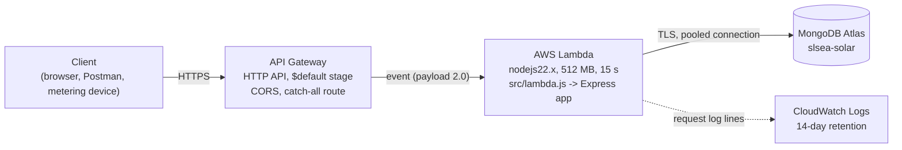

# Deployment (AWS Lambda + API Gateway HTTP API)

**Live URLs** (stack `slsea-solar-api`, ap-south-1):

| What       | URL                                                                           |
| ---------- | ----------------------------------------------------------------------------- |
| API base   | https://m9ax7pv54m.execute-api.ap-south-1.amazonaws.com/api/v1                |
| Swagger UI | https://m9ax7pv54m.execute-api.ap-south-1.amazonaws.com/api-docs/             |
| Raw spec   | https://m9ax7pv54m.execute-api.ap-south-1.amazonaws.com/api-docs/openapi.json |

Verified on 2026-10-09: `/api/v1/health` reports `data_source: mongo` with the
seeded counts, Swagger UI and its assets load, and `npm run smoke` passes all 8
checks against the live URL. [coverage-map.md](coverage-map.md) has the full set of
live curl results.

## Architecture



- **API Gateway (HTTP API)** gives the HTTPS endpoint. It has one route, the catch-all
  `$default` route, so every method and path goes to the function and Express does
  all the routing, including 404 and 405. The `$default` stage means the URL has no
  stage prefix, so paths are exactly the ones the app serves. API Gateway also
  answers CORS preflight requests, with the same headers the app uses.
- **Lambda** runs the same Express app as `npm start`. [src/lambda.js](../src/lambda.js)
  wraps it with `serverless-http`, which turns the API Gateway event into a Node
  request and Express's response back into what API Gateway expects. Before each
  event it waits for the MongoDB connection, which is opened once per container and
  reused by every request that container handles while it stays warm.
- **MongoDB Atlas** holds the data, loaded with `npm run seed:mongo`.

[src/server.js](../src/server.js) is still the entry point when running locally. No
other application code changed: the app was already built separately from
listening (`app.js` and `server.js`), and the connection in `src/config/db.js` was
already cached per process.

## What is in the package

`sam build` runs `npm pack`, so only the paths listed in `"files"` in
`package.json` go into the function: `src/` and `docs/openapi.yaml`, which Swagger
UI is built from. Then it installs production dependencies only. `data/`, `tests/`,
`scripts/`, `docs/reference/`, `.env` and dev dependencies are left out.
`npm run deploy` checks this after the build and stops if any of them are present.
The package is about 30 MB unzipped, against Lambda's limit of 250 MB.

## One-time setup

1. Install the AWS CLI and SAM CLI, and give the AWS CLI credentials:
   ```sh
   brew install awscli aws-sam-cli
   aws configure          # access key, secret, region ap-south-1
   aws sts get-caller-identity   # check the credentials work
   ```
2. **Atlas network access.** Lambda functions have no fixed IP address, so a
   single-IP entry (like the one used for local development) does not let them
   connect. In Atlas, under _Network Access_, add `0.0.0.0/0`. The database is
   still protected by its user name and password (from a NoEcho parameter) and by
   TLS. The alternative is to put the function in a VPC with a NAT gateway and a
   fixed Elastic IP, or to use VPC peering or PrivateLink. That is more secure but
   costs money every hour, which is not justified for coursework.
3. `.env` must contain `MONGODB_URI`, `JWT_SECRET` and (optionally) `MONGODB_DB`.

## Commands

```sh
npm run deploy    # sam build, check the package, then sam deploy (stack slsea-solar-api, ap-south-1)
npm run logs      # follow the function's CloudWatch logs (sam logs --tail)
npm run destroy   # delete the stack (sam delete; asks for confirmation)
```

`npm run deploy` ([scripts/deploy.js](../scripts/deploy.js)) runs:

```sh
sam build
sam deploy --stack-name slsea-solar-api --region ap-south-1 --resolve-s3 \
  --capabilities CAPABILITY_IAM --no-confirm-changeset --no-fail-on-empty-changeset \
  --parameter-overrides MongoDbUri=<from .env> JwtSecret=<from .env> MongoDbName=<from .env>
```

The script reads the values from `.env` itself and passes them straight to `sam`
without a shell, so they never appear in the terminal or the shell history. The
template marks `MongoDbUri` and `JwtSecret` as `NoEcho`, so SAM and the
CloudFormation console show them as `****`. `samconfig.toml` holds only the stack
name and region, never a parameter value. `--resolve-s3` lets SAM create and reuse
its own bucket for the upload.

After deploying, check the live API:

```sh
npm run smoke -- https://<api-id>.execute-api.ap-south-1.amazonaws.com
curl https://<api-id>.execute-api.ap-south-1.amazonaws.com/api/v1/health
```

The smoke test writes one real reading to INST-0001, so the readings count in
`/health` goes up by one each time. Run `npm run seed:mongo` to reset the database.

## Environment variables (set by the template)

| Variable      | Value                                    | Source                                     |
| ------------- | ---------------------------------------- | ------------------------------------------ |
| `NODE_ENV`    | `production`                             | fixed in `template.yaml`                   |
| `DATA_SOURCE` | `mongo`                                  | fixed in `template.yaml`                   |
| `MONGODB_URI` | the Atlas connection string (secret)     | `MongoDbUri` parameter (NoEcho), from .env |
| `MONGODB_DB`  | database name (default `slsea-solar`)    | `MongoDbName` parameter, from .env         |
| `JWT_SECRET`  | token signing secret (secret, 32+ chars) | `JwtSecret` parameter (NoEcho), from .env  |

The other settings (`JWT_EXPIRES_IN`, `CORS_ORIGIN`, `BODY_LIMIT`) keep their
defaults. The secrets end up as Lambda environment variables, which AWS encrypts
at rest. Anyone with access to the function's configuration in the AWS account can
still read them. AWS Secrets Manager would avoid that, at a small monthly cost and
with more code.

## Logs

`npm run logs` follows the function's log group, `/aws/lambda/<function name>`.
Each request writes one line:

```
<request id> GET /api/v1/health 200 168 - 12.3 ms
```

On Lambda the request id is API Gateway's own request id: serverless-http passes it
in as `X-Request-Id`, and the app reuses it. So the `X-Request-Id` a client receives
finds its log line. Logs contain only the method and URL, never headers or bodies,
so tokens, device keys and passwords are never logged. The template keeps logs for
14 days.

## Known limits

- **Cold starts.** The first request to a new container loads Node and the app,
  then opens the TLS connection to Atlas. Run locally against Atlas, the packaged
  handler took about 2.5 s for its first request and well under a second after
  that. Requests to a warm container skip all of this. Provisioned concurrency
  would remove cold starts, but it is charged by the hour.
- **The 6 MB response cap.** A Lambda response behind API Gateway cannot be larger
  than 6 MB, so no response may grow without limit. Every collection is
  paginated, and `page_size` is capped at 200 (a larger value gives 400). The
  biggest pages are small:

  | Response                                   | Size    |
  | ------------------------------------------ | ------- |
  | `/installations?page_size=200`             | ~85 KB  |
  | `/readings?page_size=200`                  | ~31 KB  |
  | `/api-docs/swagger-ui-bundle.js` (largest) | ~1.6 MB |

  Without the cap, `/readings` would hold all 131,000 readings, about 20 MB, and
  the request would fail.

- **Request size.** HTTP API accepts bodies up to 10 MB, but the app refuses JSON
  bodies over 100 KB with 413 (`BODY_LIMIT`).
- **Timeouts.** The function times out after 15 s, below HTTP API's 30 s limit, so
  a stuck request ends with a Lambda error rather than holding a connection open.
  MongoDB server selection gives up after 5 s. If the database is unreachable, the
  handler returns **503** with `Retry-After: 5` in the usual error format.
- **Database connections.** Each warm container keeps its own connection pool (at
  most 10). Under heavy load Lambda starts more containers, each opening its own
  connections, so a free Atlas cluster's connection limit could be reached. Setting
  reserved concurrency on the function would cap this.
- **No in-memory state.** Containers come and go, so nothing is kept between
  requests except the database connection. The app already keeps nothing else
  (tokens are stateless JWTs).
